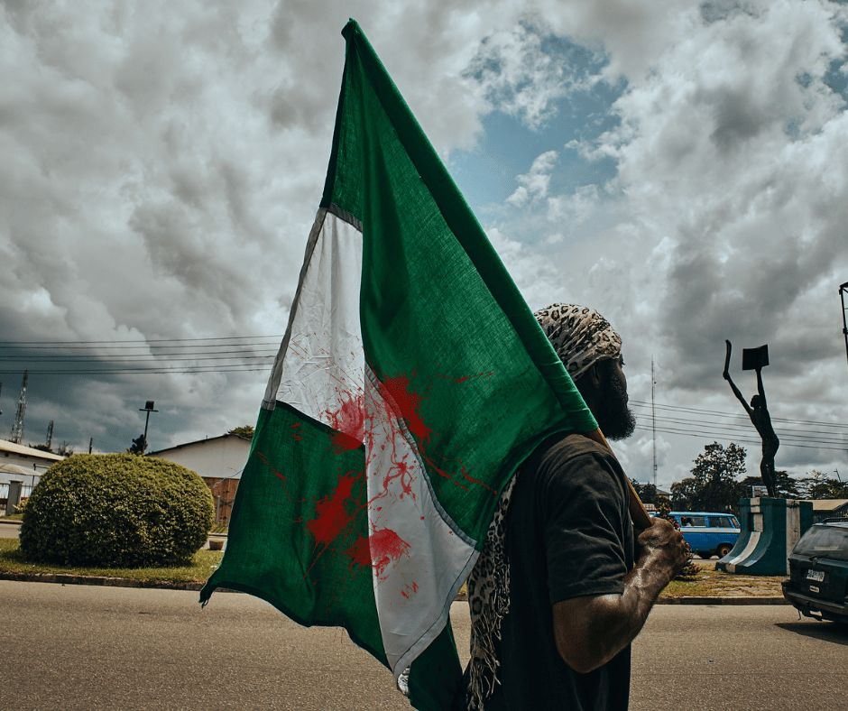

It was a Saturday afternoon, and I had sprawled on my bed, ready to bask in the exhilaration of a day off from the usual hustle and bustle of making a living. As I settled in front of the television to watch my favourite medical series, “Grey’s Anatomy,” the unreliable managers of Nigerian electricity cut off the power. Grumbling amidst high hopes of getting the power back soon, my impatience got the better of me, and I hurried to the nearest fueling station to get fuel for the generator.

At the station, the queue was insufferable, and I was further disheartened to learn that a fuel scarcity was looming. If there’s anything Nigerians have a knack for, it’s panic-buying. After waiting endlessly for my turn, I managed to afford only three litres.

Next, I headed to the market in search of something to satisfy my hunger. Unfortunately, the traders had also been alerted about the imminent fuel scarcity and decided to profit off the predicament of others, an all-too-familiar Nigerian attitude. Their highly inflated prices were the final straw for my burgeoning anger. I became gravely mad at the universe, the country, and most importantly, the leaders.

In recent times, things have fallen apart in Nigeria. The cost of living has gone from bad to worse due to the unstable trajectory of global crude oil prices. The country, which is supposed to be on its way to development, has gone from being the premier African voice to a dissenting cacophony. It is no news, however, that bad governance has plagued the nation since my great-grandmother was a toddler. But for the hopes of the masses to soar high in expectation of the much-vaunted change, only to come crashing down in an even more ironic epic way, leaves us with no hope for a salvific turnaround.

When we continually maintain the status quo of economic haemorrhaging, even with episodic changes of government and transfers of power, one can no longer just stay silent and watch. Yet, the blind patriots argue that there is nothing wrong with the country and that it is no different from other nations. They claim there is no yardstick to compare Nigeria against other countries in a negative light and would call us pessimists if we engaged them in existential debates.

When we complain of corruption, insecurity, and underdevelopment in Nigeria, they tell us that in South Africa, gang culture and xenophobic attacks, armed robbery, and killings are the order of the day. The same goes for America, where minors carry guns around, and Europe, Malaysia, and other places. So why the hue and cry about Nigeria?

How do we compare Nigeria, a third-world country, to these already developed areas when the corruption in those countries doesn’t seem to have a direct impact on the citizens? In those places, criminals do not often walk free because nosy journalists do their jobs in accordance with the law.

In Nigeria, however, it takes aeons for common criminal exploits to be exposed, such as incessant abductions, rapes, and eventual murders. Our security and law enforcement officers have become our worst nightmares, with bullets meant for criminals landing in the hearts of innocent citizens. The journalists, on the other hand, cannot even expose corrupt police officers, let alone corrupt politicians. How can they, when they are like praise singers selling awards every two months to the crème de la crème, who constantly obstruct their journalistic view with clean mints of naira? They immerse their noses in the personal lives of bigwigs and threaten to expose their foul-smelling, unclad butts if the naira doesn’t scratch their palms.

It is foolhardy for anyone to compare Nigeria to America; we should be comparing it with Ghana, Egypt, or countries that gained independence around the same time, and with pure statistics too, that is, if we even have records. How many people get shot at a political rally and the police don’t even catch the killer? How many people take a knife into the house of the senate, kill their targets, and walk away through the front door? How many people go around raping underage kids and get off with a miserly N5,000 fine in America, the UK, and the like?

We chant the national anthem of change, but we fail to ask who is going to effect this change. Is it the leaders who have served multiple terms and left the country the way it was, or even in worse states? Or the ones who, if they manage to get a taste of power, instead of proving they have good heads on their shoulders, go dancing to the catastrophic tunes of power-drunk advisers of doom, just so they may stand a chance of re-election?

The blame for the present economic predicament has constantly shifted from one hand to another, with the final straw coming from President Muhammadu Buhari, who, in an interview broadcast, said Nigeria has itself to blame for the economic troubles. The question is, who is Nigeria, if not you and I?