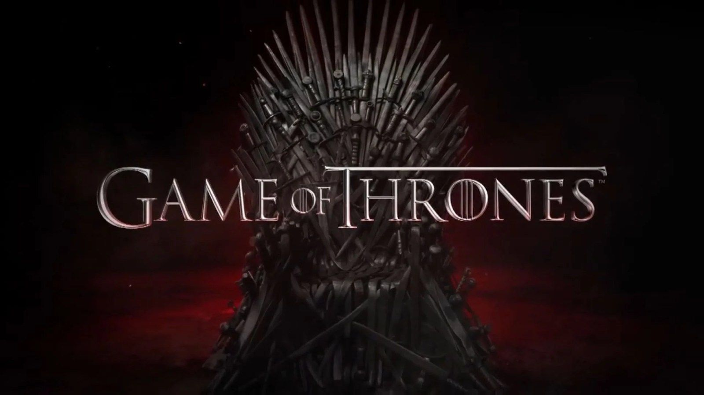

Books have been written, stories told, movies made, and pictures painted depicting the deteriorating state of leadership and poor managerial skills across various sectors. Despite these portrayals, the rift continues to widen, and many remain ensnared in poor leadership choices. Among the many movies and television shows that have tackled this theme, one stands out rather blatantly, *Game of Thrones*, a fantasy series by George R.R. Martin, later adapted into a TV show. From April 14th to 20th, 2019, search interest in Nigeria for ‘Game of Thrones’ on Google soared to 100 percent. While the HBO TV show captivated audiences with its compelling narrative, it also offers profound lessons on leadership and innovation that many seem to overlook.

In *Game of Thrones*, following the death of King Robert Baratheon, who succeeded the mad King Targaryen, a fierce struggle ensues over who should claim the crown. The plot reveals a futile power struggle among various houses vying for control of the Seven Kingdoms.

Similar to Westeros, the fictional continent in the series, Nigeria has long been plagued by a dearth of effective leadership and innovative skills. Various political factions continue to engage in fruitless battles, with no true role model emerging to champion the cause for societal betterment and emancipation. Leaders come and go, yet the entities and people they lead experience little to no positive change.

Leadership is fundamentally an action-oriented concept, not merely a personality or a structure dominated by a select few. It exists at multiple social layers, within families, small communities, professional associations, religious institutions, multinational corporations, and government bodies. Leadership and innovation are often perceived as mysterious and charismatic, and as their scarcity deepens, the demand in the corporate world grows.

The poor leadership choices of many characters in *Game of Thrones* often result in disastrous consequences, much like the poor decisions made by many Nigerian managers that lead to the decline or stagnation of their businesses. One might assume that with today’s technological advancements, there would be a more streamlined development process that could reduce the need for leaders or managers. However, studies reveal that regardless of a company’s function, goals, resources, and market, poor leadership and a lack of creativity can undermine any business.

Ultimately, the success of a business hinges on its leader and their managerial approach. Ineffective leadership is often the root cause of a company’s problems. So, what is the remedy? As Peter Drucker wisely stated, “Effective leadership is not about making speeches or being liked; leadership is defined by results, not attributes.” Similarly, Steven Jeffes asserted that "Innovation is the unrelenting drive to break the status quo and develop anew where few have dared to go."

In the show, Daenerys Targaryen’s ambitious vision and creativity drive her to break the wheel of oppression, progressing from a sex slave to the Mother of Dragons over eight seasons.

Moreover, when Tywin Lannister questions young King Tommen Baratheon about what makes a good leader, Tommen’s responses range from holiness and justice to strength and wisdom, all of which Tywin refutes with historical examples of failed leadership. Tywin said, "A wise king knows what he knows and what he doesn’t. A wise young king listens to his counsellors and heeds their advice until he comes of age. And the wisest kings continue to listen to them long afterwards."

Applying this to the business world, leaders are not born; they are made. Behavioural theories suggest that people can become leaders through teaching, learning, and observation. Leadership is a set of skills that can be developed through training, perception, practice, and experience over time.

Therefore, the need for leadership training, conferences, and summits cannot be overemphasised, especially in a country like Nigeria with a history of poor leadership. A recent analysis of leadership training highlights that while the U.S. spends $166 billion annually on organisational training, Africa faces a significant shortfall in productive training.

This is a call to action for Africans, and Nigerians in particular, to seize every training opportunity. At the core of every successful business lies a great idea and an inspired leader.